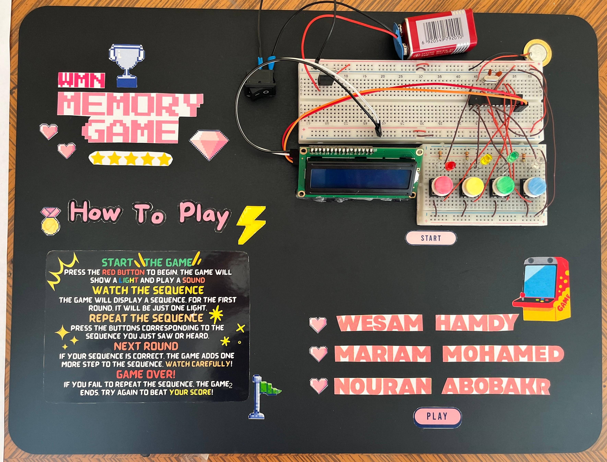
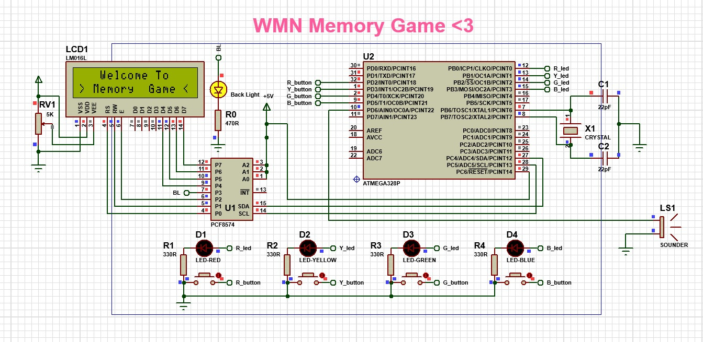

# Memory Game on ATmega328P

A "Simon Says"-style memory game built on a bare **ATmega328P** microcontroller. The game flashes a growing sequence of coloured LEDs with matching tones, and the player repeats it on four push buttons. A 16x2 I2C LCD shows the level and the game status. The circuit was designed and simulated in **Proteus**, and the firmware is written in **C/C++ (Arduino framework)**.

University project, Faculty of Engineering, Menoufia University (Dec 2024).





## Features

- Random sequence that grows by one step each level (up to 50 levels)
- Four colours (red, yellow, green, blue), each with its own LED, button and tone
- 16x2 LCD over I2C (PCF8574), using only 2 microcontroller pins for the display
- Feedback for every state: level number, "Memorize", "Play", "Verification", win and game over
- Game logic structured as a **state machine** (`switch` on `stage`)

## How the game works

The main loop is a state machine with 7 stages:

| Stage | What happens |
|---|---|
| 0 | Idle: LCD shows "Press Red Button for Start Game" |
| 1 | Shows the level, adds one random colour to the sequence, and plays the whole sequence (LEDs + tones) |
| 2 | Switches the LCD to "Play" |
| 3 | Reads the buttons and records the player's presses, with LED and tone feedback |
| 4 | Compares the player's input with the sequence |
| 5 | Wrong input: "You Lost / GAME OVER" tone, then back to stage 0 |
| 6 | Correct input: "You Win", next level (after level 50: "Level Complete" and restart) |

## Hardware

| Component | Details |
|---|---|
| Microcontroller | ATmega328P, 16 MHz crystal with 2 × 22 pF capacitors |
| Display | LM016L 16x2 LCD with PCF8574 I2C backpack (address `0x27`), 5 kΩ contrast potentiometer |
| Inputs | 4 push buttons (internal pull-ups, active low) |
| Outputs | 4 LEDs with 330 Ω resistors, piezo buzzer |
| Power | 9 V battery with LM7805 5 V regulator |

### Pin mapping

| Function | Arduino pin | ATmega328P pin |
|---|---|---|
| Red button / Red LED | D2 / D8 | PD2 / PB0 |
| Yellow button / Yellow LED | D3 / D9 | PD3 / PB1 |
| Green button / Green LED | D4 / D10 | PD4 / PB2 |
| Blue button / Blue LED | D5 / D11 | PD5 / PB3 |
| Piezo buzzer | D6 | PD6 |
| LCD I2C SDA / SCL | A4 / A5 | PC4 / PC5 |

## Repository structure

```
src/Arduino_Code/   Firmware (Arduino_Code.ino) + LiquidCrystal_I2C library files
proteus/            Proteus 8 project (WMN_MG.pdsprj) + compiled firmware (Arduino_Code.ino.hex)
docs/               Project report (PDF) and poster
images/             Circuit diagram
```

## How to run

### In Proteus (simulation)

1. Open `proteus/WMN_MG.pdsprj` in Proteus 8.
2. Double-click the ATmega328P and set **Program File** to `proteus/Arduino_Code.ino.hex`. Check that the clock is 16 MHz.
3. Press Play, then press the red button to start.

### On hardware / rebuilding the firmware

1. Open `src/Arduino_Code/Arduino_Code.ino` in the Arduino IDE. The library files are in the same folder, so no install is needed.
2. Select **Arduino Uno** as the board (same ATmega328P chip).
3. Upload to the board, or use **Sketch → Export Compiled Binary** to produce a new `.hex` for Proteus.

## Acknowledgements

- The LCD driver in `src/Arduino_Code/LiquidCrystal_I2C.*` is the open-source **LiquidCrystal_I2C** Arduino library, included here so the sketch builds as-is.
